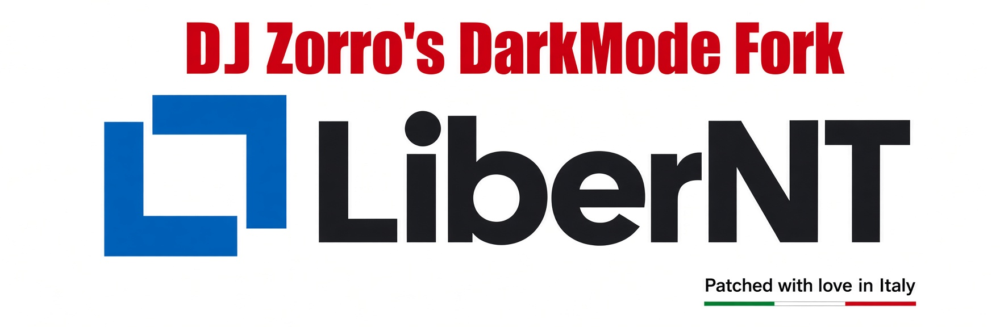
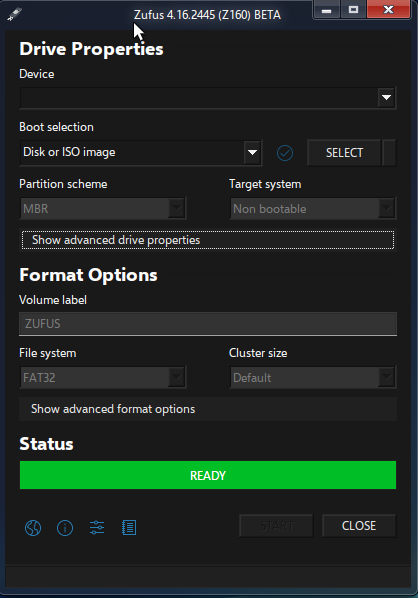

<!-- fork README -->

  

= Latest news  =

* I now run my fork on my laptop, and I'm checking out the main LibreNT every day
* I already found two big bugs: one on MTU of IP interfaces, another on polling of Tablet
* If you have an Intel laptop of circa 2018-2023 check it out (you can download the ISO and update the fork automatically)

= ZorroDJ LibreNT & ZUFUS  =

I fell in love with [LiberNT](https://github.com/LiberNT/LiberNT) immediately: this product is an atomic bomb, and it can be one of the most disruptive products, together with [ElixirOffice](https://github.com/leag1234/elixiroffice) (and [LibreOffice](https://github.com/libreoffice) itself), to remove the cancer represented by Microsoft products. Even for the most Linux-minded companies, the ones irreducibly committed to getting rid of their dependency on Microsoft products, it is practically impossible not to have Windows on some workstations for legacy reasons. LiberNT is a concrete hope: this GitHub fork contains my personal fix to DarkMode - keep reading about why...

While testing my fork of [RUFUS](https://github.com/pbatard/rufus) that also runs under Linux (through wxWidgets), I noticed that the implementation inside uxtheme.dll / win32kfull.sys had a lot of stubs and the dark mode rendering was insufficient: the internal APIs used by wxWidgets (AllowDarkModeForWindow, SetPreferredAppMode, IsDarkModeAllowedForWindow, RefreshImmersiveColorPolicyState, FlushMenuThemes, ShouldAppsUseDarkMode) are ordinal-only exports, with no headers/SDK and no public contract. A clean-room implementation was done by analyzing Microsoft symbols, Wine/ReactOS, and running empirical tests.

The result is going from this to this:

**Before**

**After**

## What was implemented

- Per-process preferred app mode (Default / AllowDark / ForceDark / ForceLight).
- Per-window dark mode property with `GA_ROOT` fallback, mirrored to the DWM immersive-dark property for title bars.
- Real `IsDarkModeAllowedForWindow`, `ShouldAppsUseDarkMode`, `AllowDarkModeForWindow`,
  `SetPreferredAppMode`, `RefreshImmersiveColorPolicyState` and `FlushMenuThemes`.
- `DarkMode_*` / `DarkMode::*` class normalization, including the `DarkTheme` -> `Window` alias.
- Dark system palette in win32k and automatic light/dark palette switching.
- Nonclient caption follows the effective dark mode state.
- Unattended live-CD boot: no key wait, `TimeOut=0`, ISO 9660:1999 remaster that keeps
  El Torito BIOS/UEFI hybrid boot.

## Where it lives

- Branch: `darkmode`
- Fork: https://github.com/ZorroDJ/LiberNT
- Reference screenshots: [`darkmode-analysis/`](darkmode-analysis/)

## Testing

The patched build was compiled with RosBE (`--clang --release`, one job at a time) and
tested in QEMU with the live ISO plus a virtual USB stick containing ZUFUS
`4.16.2445-Z160-win64.exe`. Desktop, Explorer, taskbar, wxWidgets warning dialog and
the whole ZUFUS window render dark; no assertions were logged on COM1.

## ISO builds synced with original LiberNT

Here you can find updated AMD64 ISO builds with proper DarkMode and everything else from LiberNT stock synced: https://github.com/ZorroDJ/LiberNT/releases
